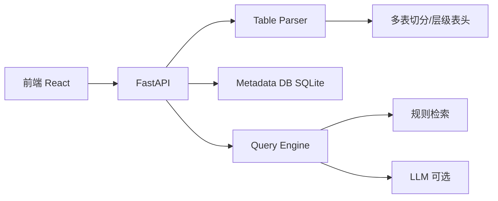

# 项目实施计划

## 目标

构建一个面向异构数据治理的 Web 平台 MVP：

1. 用户上传混乱表格（CSV/XLSX）
2. 填写整体描述并回答系统生成的问答
3. 系统自动识别多表、拆分区域、解析层级表头
4. 用户自然语言提问，系统返回答案 + 来源追溯

## 阶段划分

### Phase 1（当前已完成）：前后端 MVP

- [x] FastAPI 后端骨架
- [x] 文件上传 API
- [x] 多表识别 / 空行空列切分
- [x] 多层表头展平
- [x] 上传问答流程
- [x] 规则式智能查询 + 来源追溯
- [x] React 三页前端（上传 / 查询 / 目录）
- [x] 示例混乱 CSV 数据

### Phase 2：表格理解增强

- [ ] openpyxl 合并单元格精确解析
- [ ] 表内层级行（小计/汇总行）识别
- [ ] 跨表关系候选推断（join path 推荐）
- [ ] 上传问答改为 LLM 动态生成

### Phase 3：查询能力增强

- [ ] 接入 LLM / NL2SQL（可选 ReAct）
- [ ] 用户确认候选对象后再生成 SQL
- [ ] 执行反馈修正（空结果、错误 join）
- [ ] 查询计划可视化

### Phase 4：治理与评价

- [ ] 元数据版本管理与操作日志
- [ ] 实验任务样例库
- [ ] 过程性评价指标（命中率、交互轮次、可复核性）

## 系统架构

## 第一步怎么跑

1. 安装 Python 3.11+（Windows 需从 python.org 安装，不要用 Store 占位符）
2. 启动后端：`web/start-backend.bat`
3. 启动前端：`web/start-frontend.bat`
4. 上传 `web/sample_data/messy_emissions.csv`
5. 完成问答后在「智能查询」提问：`告诉我美国阿拉斯加州的 NOx 排放量`
